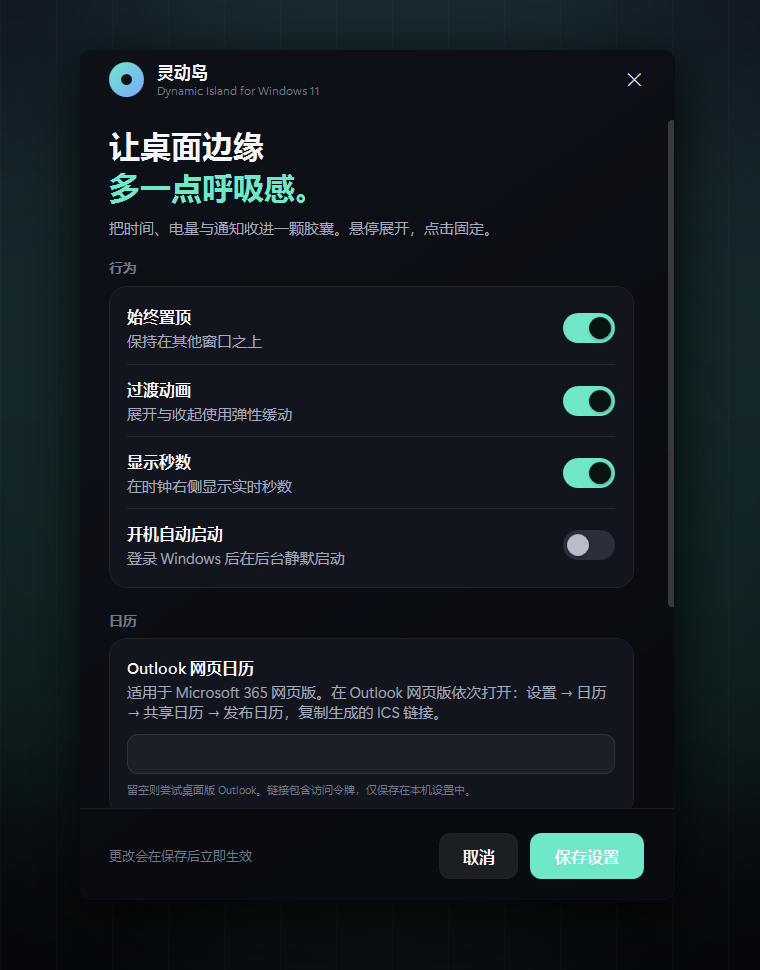
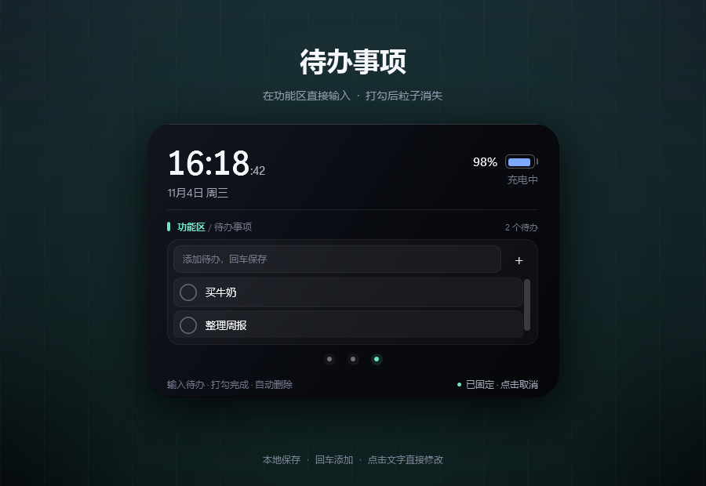

# 灵动岛 · Dynamic Island for Windows 11

> 一颗停靠在桌面顶部的胶囊。悬停展开，右下角固定。


**当前状态：`0.1.0` 可运行开发骨架。** 窗口、动画、托盘、设置、开机启动、通知胶囊、常用软件快捷方式和待办事项都已在本机实机跑通；日历模块支持 **Microsoft 365 网页版 ICS 链接**，也保留桌面版 Outlook COM 回退。本机通过本地 HTTP ICS 源实测了获取、重复日程展开、全天日程和列表 UI，未使用真实 Microsoft 365 账号链接测试。

## 现在能做什么

- 紧贴屏幕顶部的无边框透明胶囊，始终置顶，不占用任务栏
- 胶囊主标签显示当前 Windows 登录名（本机为 `klein`）
- 悬停自动放大展开，移开自动收起；右下角独立按钮固定 / 取消固定
- 展开 `300ms`、收起 `360ms` 弹性尺寸动画 + 顶部中心缩放 + 内容错峰交叉淡化
- 实时时钟、日期、秒数、电池 / 充电状态
- **三个标签用圆点按钮切换**：常用软件 / Calendar / 待办事项
- **常用软件**：六个快捷方式格子，拖入 `.lnk/.exe/.url/.appref-ms`，单击打开；悬停时格子放大、唱片滑出并旋转
- 快捷方式支持移除、替换和本地持久化，最多 6 个
- **Calendar**：支持 Microsoft 365 网页版发布的 ICS 链接，读取今日日程（时间、主题、地点、全天、重复事件）；也回退桌面版 Outlook COM
- 日历支持加载中、无日程、链接失效、未配置来源、重试和手动刷新
- **待办事项**：在标签直接输入或修改，打勾后粒子散开、整行淡出并从列表删除；待办持久化到本机
- 通知胶囊：标题 + 正文 + 自动消失 / 点击关闭（当前由托盘和右键菜单触发演示）
- 深色设置页：置顶、动画、秒数、开机启动、不透明度、顶部距离（默认 `0` = 贴顶）
- 系统托盘图标与右键菜单
- 右键菜单：设置、演示通知、隐藏到托盘、退出
- 单实例运行；Alt+F4 默认隐藏到托盘而不是退出
- 配置 JSON 原子写入、启动 / 崩溃日志、开机启动注册表项

## 技术选型

| 层 | 选择 | 原因 |
| --- | --- | --- |
| 运行时 | **.NET 10 / WPF** | Windows 原生、单文件发布，目标机无需安装 .NET |
| 窗口 | WPF 透明分层窗口 + Win32 样式 | 胶囊外形、逐帧尺寸动画和阴影都可控 |
| 系统集成 | Win32 P/Invoke + WinForms `NotifyIcon` | 托盘、电源状态、点击穿透边距，不引入第三方 UI 包 |
| 日历 | Outlook 网页 ICS + `Ical.Net` 4.3.1；桌面 COM 回退 | 不依赖 Azure 应用注册；`Ical.Net` 负责 RFC 5545 重复日程展开 |
| 配置 | `System.Text.Json` + Core 层 | UI 无关、可单测、原子写入 |
| 测试 | xUnit | Core 层 10 个单元测试 |

运行时第三方依赖仅有 `Ical.Net` 4.3.1（MIT）及其 `NodaTime` 3.2.0（Apache-2.0），用于解析 ICS；详见 [THIRD-PARTY-NOTICES.md](THIRD-PARTY-NOTICES.md)。

### 设置页



### 待办事项



在待办标签顶部输入后按回车，或点 `+` 添加。每条待办的文字可以直接点击修改；点左侧圆圈打勾，粒子会从勾选处散开，整行淡出后从列表和本地文件中删除。待办会保存在本机，重启后仍在。

## 配置 Microsoft 365 网页版日历

使用的是网页版 Outlook 时，不需要安装桌面版 Outlook，也不需要 Azure 应用注册。通过 Outlook 网页版的“发布日历”生成一个只读 ICS 链接即可：

1. 浏览器打开 [Outlook 网页版](https://outlook.office.com/calendar/)。
2. 右上角 **设置 → 日历 → 共享日历 → 发布日历**。
3. 选择要显示的日历，权限建议选 **可查看所有详细信息**，然后发布并复制 ICS 链接。
4. 打开灵动岛的 **设置 → 日历**，把链接粘贴到“Outlook 网页日历 ICS 链接”，保存。
5. 展开灵动岛，点击下方的第二个圆点，再点“刷新”。

注意事项：

- ICS 链接里含有私人访问令牌，请勿截图或分享；可在同一页面取消发布来撤销链接。
- 链接可以填 `https://` 或 `webcal://`；也支持本地 `.ics` 文件路径，方便离线测试。
- 如果管理员禁用了“发布日历”，当前 ICS 方案不可用，需要改用 Microsoft Graph + OAuth。
- 链接留空时会尝试桌面版 Outlook COM，不会主动发起网络请求。

## 快速开始

### 1. 初始化开发环境

```powershell
powershell -NoProfile -ExecutionPolicy Bypass -File .\scripts\bootstrap.ps1
```

脚本会：

1. 检查 .NET 10 SDK；没有则用官方 `dotnet-install.ps1` **用户级安装**（不需要管理员）。
2. 把 SDK 写入用户 `PATH` 和 `DOTNET_ROOT`。
3. 还原依赖、构建解决方案、运行单元测试。

> 如果当前终端是在安装前打开的，请新开一个终端，让 `PATH` 和 `DOTNET_ROOT` 生效。

### 2. 运行

```powershell
# 带示例展开态启动，适合快速看效果
powershell -NoProfile -ExecutionPolicy Bypass -File .\scripts\run.ps1 -Demo

# 直接打开设置页
powershell -NoProfile -ExecutionPolicy Bypass -File .\scripts\run.ps1 -Settings

# 普通启动
powershell -NoProfile -ExecutionPolicy Bypass -File .\scripts\run.ps1
```

也可以在 VS Code 中打开项目，按 `F5` 使用「灵动岛 (Debug + demo)」配置。

### 3. 发布独立 exe

```powershell
powershell -NoProfile -ExecutionPolicy Bypass -File .\scripts\publish.ps1
```

默认产出 **win-x64、self-contained、single-file**：

```text
artifacts/publish/DynamicIsland-0.1.0-win-x64/DynamicIsland.exe
artifacts/publish/DynamicIsland-0.1.0-win-x64.zip
```

目标机器不需要安装 .NET。ARM64：

```powershell
.\scripts\publish.ps1 -Runtime win-arm64
```

## 操作

| 操作 | 效果 |
| --- | --- |
| 鼠标移入胶囊 | 放大展开 |
| 鼠标移开 | 320ms 后平滑收起（未固定时） |
| 左键单击胶囊 | 展开；不改变固定状态 |
| 点击右下角“固定窗口” | 固定 / 取消固定；这是唯一的固定入口 |
| 编辑待办时鼠标移开 | 暂时保持展开，焦点离开后再收起 |
| 点击下方圆点 | 切换「常用软件」「Calendar」和「待办事项」 |
| 把快捷方式拖到岛上 | 填入第一个空位；拖到已有格子可替换 |
| 鼠标滑过快捷方式 | 格子放大，唱片滑出并旋转 |
| 单击快捷方式 | 用资源管理器打开该软件 |
| 悬停后点右上角 × | 移除该快捷方式 |
| 日历页点击刷新 | 重新读取今日日历（网页 ICS 或桌面 Outlook） |
| 右键单击 | 打开菜单 |
| 托盘图标双击 | 显示灵动岛 |
| 托盘图标右键 | 显示、设置、演示通知、开机启动、退出 |

命令行参数：

```text
--demo         启动后展开，方便截图 / 调试
--settings     启动后直接打开设置窗口
--autostart    由开机启动项使用；重复实例时静默退出
```

## 开发命令

```powershell
.\scripts\build.ps1                 # Debug 构建
.\scripts\build.ps1 -Configuration Release
.\scripts\test.ps1                  # 单元测试
.\scripts\run.ps1 -Demo             # 构建 + 运行
.\scripts\publish.ps1               # 自包含单文件发布
```

全部脚本都兼容 Windows PowerShell 5.1。若系统执行策略限制 `.ps1`，统一用：

```powershell
powershell -NoProfile -ExecutionPolicy Bypass -File .\scripts\build.ps1
```

## 项目结构

```text
dynamic-island/
├─ src/
│  ├─ DynamicIsland.Core/           # 无 UI 依赖：配置、尺寸、定位
│  │  ├─ Layout/IslandPlacement.cs
│  │  ├─ Models/IslandMetrics.cs
│  │  ├─ Models/IslandSettings.cs
│  │  └─ Services/SettingsStore.cs
│  └─ DynamicIsland.App/            # WPF 宿主
│     ├─ Interop/NativeMethods.cs
│     ├─ Services/                  # 托盘、启动、日志、日历、待办、快捷方式、图标
│     ├─ ViewModels/
│     ├─ Views/IslandWindow.*
│     ├─ Views/SettingsWindow.*
│     └─ Themes/Theme.xaml
├─ tests/DynamicIsland.Core.Tests/
├─ scripts/                         # bootstrap / build / test / run / publish
├─ docs/                            # 架构、开发说明、路线图
├─ .vscode/                         # 构建任务、调试配置
└─ DynamicIsland.sln
```

## 配置与日志

| 内容 | 路径 |
| --- | --- |
| 设置 | `%LOCALAPPDATA%\DynamicIsland\settings.json` |
| 快捷方式 | `%LOCALAPPDATA%\DynamicIsland\shortcuts.json` |
| 待办 | `%LOCALAPPDATA%\DynamicIsland\todos.json` |
| 日志 | `%LOCALAPPDATA%\DynamicIsland\logs\app.log` |
| 开机启动 | `HKCU\Software\Microsoft\Windows\CurrentVersion\Run\DynamicIsland` |

设置和网页日历链接都由 `%LOCALAPPDATA%` 保存；只有配置了 ICS 链接时，应用才会请求该链接，不上传日历内容。损坏的配置会回退到默认值，不会阻止启动。

## 当前限制

- 常用软件只支持 `.lnk`、`.exe`、`.url`、`.appref-ms` 四类文件，最多 6 个；快捷方式路径保存在本机，不会复制软件本身。
- 待办最多 20 条、每条 120 字；打勾即删除，没有“已完成历史”。待办保存在本机，不上传。
- 胶囊启动、托盘唤出和悬停展开不抢焦点；点击胶囊（尤其是待办输入框）会激活窗口，这是键盘输入所必需的。
- Outlook 网页日历通过**发布 ICS 链接**接入，不支持需要登录态的私有网页抓取；未使用 Microsoft Graph/OAuth。若组织禁用发布日历，需要额外做 Azure 应用注册和 Graph 授权。
- ICS 链接以明文保存在本机设置中，包含访问令牌；请勿分享设置文件。桌面版 Outlook COM 仅在未配置 ICS 链接时作为回退。
- 多显示器：Core 已预留 `PreferredScreen`，当前设置页未开放显示器选择，默认使用主屏。
- 通知目前是内置演示通道，还没有接入 Windows 通知监听。
- 尚未接入媒体控制、天气等数据源。
- 未提供 MSIX / Inno Setup 安装器和代码签名；当前通过发布目录或 zip 运行。
- 自包含单文件首次启动会把原生库解压到临时目录，这是 .NET 单文件在 WPF 下的正常行为。

后续计划见 [docs/roadmap.md](docs/roadmap.md)。

## 文档

- [开发环境与工作流](docs/development.md)
- [架构与扩展点](docs/architecture.md)
- [路线图](docs/roadmap.md)

## 环境实测

- Windows 11 `10.0.26200`
- .NET SDK `10.0.403`（用户级安装，无管理员权限）
- Visual Studio Code `1.143.1` + C# Dev Kit / C# 扩展
- MinGit `2.56.0`（可选，用于版本控制）
- 本机未安装 Outlook；网页日历已用本地 HTTP ICS 源实测（含全天、重复日程、已取消事件过滤）
- 真实 Microsoft 365 发布链接需要你自己的账号链接做最终联调；桌面版 Outlook COM 未在本机实测
- 常用软件已用 6 个真实 `.lnk` 验证图标、悬停唱片动画、单击启动、移除和重启持久化
- 待办已实测键盘输入、行内修改、打勾删除、粒子动画和重启持久化
- `dotnet build` 0 警告 0 错误；`dotnet test` 10/10 通过
