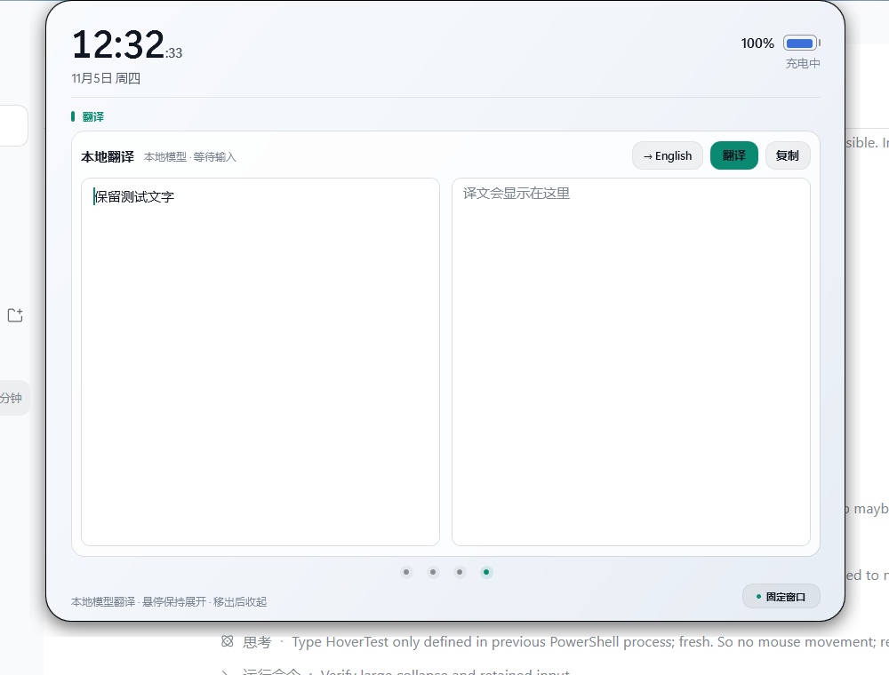
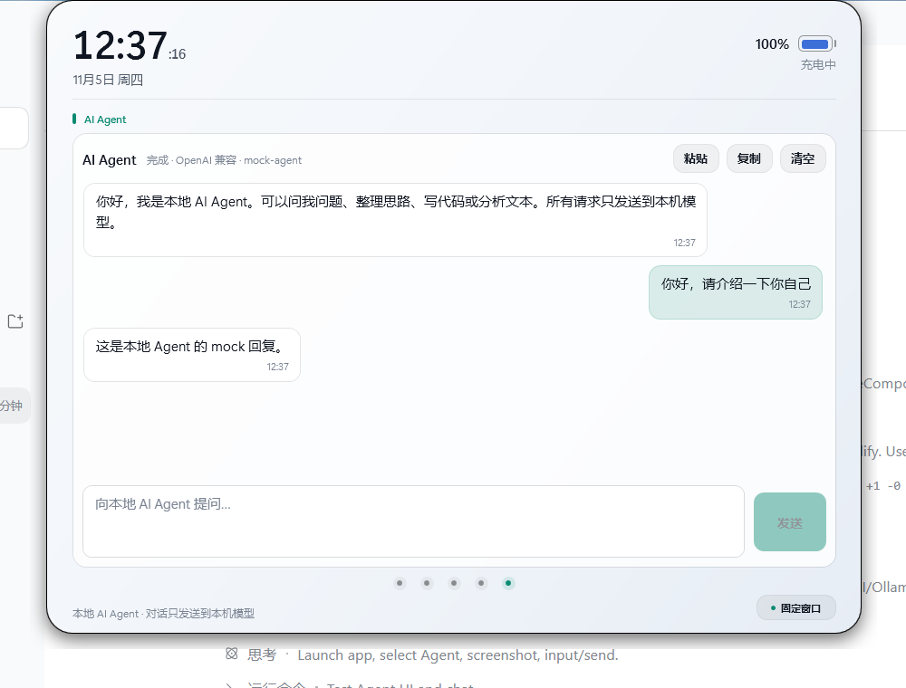
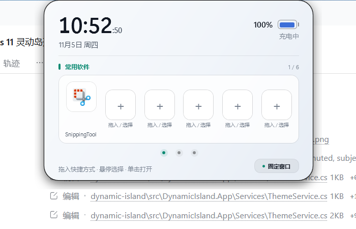

# 灵动岛 · Dynamic Island for Windows 11


> 一颗停在桌面顶部的胶囊。悬停展开，常用软件、日程、待办、翻译和本地 AI Agent 都在这里完成。


**当前版本 `v0.3.0`**（首个公开版本为 `v0.1.0`）。包含五个功能区、深/浅色双主题、会议倒计时，以及接入本机 Ollama / OpenAI-compatible 模型的翻译与 AI Agent。日历支持 Microsoft 365 发布 ICS，也保留桌面版 Outlook COM 回退。

仓库：[github.com/KleinF-02/windows-DynamicIsland](https://github.com/KleinF-02/windows-DynamicIsland) · 发布页：[Releases](https://github.com/KleinF-02/windows-DynamicIsland/releases)

**文档导航：** [软件设计思路](docs/design.md) · [框架与技术选型](docs/frameworks.md) · [使用说明](docs/usage.md) · [架构](docs/architecture.md) · [版本管理](docs/versioning.md) · [v0.3.0 更新记录](docs/releases/v0.3.0.md) · [变更日志](CHANGELOG.md) · [开发说明](docs/development.md)

## 快速开始

1. 从 [GitHub Releases](https://github.com/KleinF-02/windows-DynamicIsland/releases) 下载 `DynamicIsland-0.3.0-win-x64.zip`。
2. 解压后运行 `DynamicIsland.exe`。
3. 鼠标移到顶部胶囊展开；点击底部圆点切换功能。
4. 需要固定时点右下角“固定窗口”；右键托盘图标打开设置。

自包含发布包不需要预装 .NET。翻译 / AI Agent 需要本机运行 Ollama 或 LM Studio，并在设置中填写模型地址。

## 现在能做什么

- 紧贴屏幕顶部的无边框透明胶囊，始终置顶，不占用任务栏
- 胶囊主标签显示当前 Windows 登录名（本机为 `klein`）
- 悬停自动放大展开，移开自动收起；右下角独立按钮固定 / 取消固定
- 展开 `300ms`、收起 `360ms` 弹性尺寸动画 + 顶部中心缩放 + 内容错峰交叉淡化
- 实时时钟、日期、秒数、电池 / 充电状态
- **五个标签用圆点按钮切换**：常用软件 / Calendar / 待办事项 / 翻译 / AI Agent
- **常用软件**：六个快捷方式格子，从资源管理器或桌面拖入 `.lnk/.exe/.url/.appref-ms/.html/.htm`；也可以点击空位，从开始菜单应用选择器里选择或浏览本地网页；单击打开，悬停时格子平滑放大
- `.html/.htm` 使用系统默认浏览器图标；关联图标不可用时格子显示 `</>` 网页占位图标
- 快捷方式支持移除、替换和本地持久化，最多 6 个
- 开始菜单选择器同时收录 `%LocalAppData%\Microsoft\WindowsApps` 的应用执行别名，因此 Snipping Tool 等 Store/UWP 应用也能添加
- **Calendar**：支持 Microsoft 365 网页版发布的 ICS 链接，读取今日日程（时间、主题、地点、全天、重复事件）；也回退桌面版 Outlook COM
- 下一场会议开始前 5 分钟自动切换到 iPhone 风格圆环倒计时，显示会议主题与开始时间；倒计时到 0 后恢复今日日程
- 倒计时期间缩小后的顶部胶囊同步显示会议主题和剩余时间
- 日历支持加载中、无日程、链接失效、未配置来源、重试和手动刷新
- **待办事项**：在标签直接输入或修改，打勾后粒子散开、整行淡出并从列表删除；待办持久化到本机
- **翻译**：第四个圆点；输入文字后调用本机 Ollama / LM Studio / llama.cpp 大模型，支持切换目标语言、Ctrl+Enter 翻译、复制结果；光标在功能区时保持展开，移出后按原有悬浮规则收起，翻译内容保留到下次展开
- **AI Agent**：第五个圆点；多轮对话、保留上下文、粘贴/复制/清空，和翻译共用本地模型配置；激活时放大为工作区，并和翻译共用同一套悬停策略：光标在功能区内保持展开，移出后收起
- 通知胶囊：标题 + 正文 + 自动消失 / 点击关闭（当前由托盘和右键菜单触发演示）
- 深色 / 浅色两套主题，自动跟随 Windows“应用模式”实时切换
- 设置页：置顶、动画、秒数、开机启动、不透明度、顶部距离（默认 `0` = 贴顶）
- 系统托盘图标与右键菜单
- 右键菜单：设置、演示通知、隐藏到托盘、退出
- 单实例运行；Alt+F4 默认隐藏到托盘而不是退出
- 配置 JSON 原子写入、启动 / 崩溃日志、开机启动注册表项

## 技术选型

| 层 | 选择 | 原因 |
| --- | --- | --- |
| 运行时 | **.NET 10 / WPF** | Windows 原生、单文件发布，目标机无需安装 .NET |
| 窗口 | WPF 透明分层窗口 + Win32 样式 | 胶囊外形、逐帧尺寸动画和阴影都可控 |
| 系统集成 | Win32 P/Invoke + WinForms `NotifyIcon` | 托盘、电源状态、点击穿透边距，不引入第三方 UI 包 |
| 日历 | Outlook 网页 ICS + `Ical.Net` 4.3.1；桌面 COM 回退 | 不依赖 Azure 应用注册；`Ical.Net` 负责 RFC 5545 重复日程展开 |
| 配置 | `System.Text.Json` + Core 层 | UI 无关、可单测、原子写入 |
| 测试 | xUnit | Core 层 11 个单元测试 |

运行时第三方依赖仅有 `Ical.Net` 4.3.1（MIT）及其 `NodaTime` 3.2.0（Apache-2.0），用于解析 ICS；详见 [THIRD-PARTY-NOTICES.md](THIRD-PARTY-NOTICES.md)。

### 设置页


### 待办事项


在待办标签顶部输入后按回车，或点 `+` 添加。每条待办的文字可以直接点击修改；点左侧圆圈打勾，粒子会从勾选处散开，整行淡出后从列表和本地文件中删除。待办会保存在本机，重启后仍在。

## 配置本地翻译模型

翻译只请求本机地址。推荐 Ollama：

```powershell
ollama serve
ollama pull qwen2.5:7b
```

然后打开 **设置 → 翻译**：

- 服务地址保持 `http://127.0.0.1:11434`
- 模型名可以留空，自动选择本地第一个模型；也可以填 `qwen2.5:7b`
- LM Studio / llama.cpp 使用 OpenAI 兼容接口，例如 `http://127.0.0.1:1234`

翻译页切换目标语言后输入文字，点“翻译”或按 `Ctrl+Enter`；结果可以一键复制。切到翻译或 AI Agent 时窗口会放大到接近普通应用的 `720 × 560` 工作区，离开后恢复原来的展开尺寸。

AI Agent 支持多轮对话，会携带最近 18 条消息作为上下文；可以粘贴剪贴板、复制最后一条回复或清空对话。它只读取对话文本并请求本机模型，不会直接执行 Windows 命令、读取文件或控制应用。

### 翻译工作区



### AI Agent



### 浅色主题



## 配置 Microsoft 365 网页版日历

使用的是网页版 Outlook 时，不需要安装桌面版 Outlook，也不需要 Azure 应用注册。通过 Outlook 网页版的“发布日历”生成一个只读 ICS 链接即可：

1. 浏览器打开 [Outlook 网页版](https://outlook.office.com/calendar/)。
2. 右上角 **设置 → 日历 → 共享日历 → 发布日历**。
3. 选择要显示的日历，权限建议选 **可查看所有详细信息**，然后发布并复制 ICS 链接。
4. 打开灵动岛的 **设置 → 日历**，把链接粘贴到“Outlook 网页日历 ICS 链接”，保存。
5. 展开灵动岛，点击下方的第二个圆点，再点“刷新”。

注意事项：

- ICS 链接里含有私人访问令牌，请勿截图或分享；可在同一页面取消发布来撤销链接。
- 链接可以填 `https://` 或 `webcal://`；也支持本地 `.ics` 文件路径，方便离线测试。
- 如果管理员禁用了“发布日历”，当前 ICS 方案不可用，需要改用 Microsoft Graph + OAuth。
- 链接留空时会尝试桌面版 Outlook COM，不会主动发起网络请求。

## 快速开始

### 1. 初始化开发环境

```powershell
powershell -NoProfile -ExecutionPolicy Bypass -File .\scripts\bootstrap.ps1
```

脚本会：

1. 检查 .NET 10 SDK；没有则用官方 `dotnet-install.ps1` **用户级安装**（不需要管理员）。
2. 把 SDK 写入用户 `PATH` 和 `DOTNET_ROOT`。
3. 还原依赖、构建解决方案、运行单元测试。

> 如果当前终端是在安装前打开的，请新开一个终端，让 `PATH` 和 `DOTNET_ROOT` 生效。

### 2. 运行

```powershell
# 带示例展开态启动，适合快速看效果
powershell -NoProfile -ExecutionPolicy Bypass -File .\scripts\run.ps1 -Demo

# 直接打开设置页
powershell -NoProfile -ExecutionPolicy Bypass -File .\scripts\run.ps1 -Settings

# 普通启动
powershell -NoProfile -ExecutionPolicy Bypass -File .\scripts\run.ps1
```

也可以在 VS Code 中打开项目，按 `F5` 使用「灵动岛 (Debug + demo)」配置。

### 3. 发布独立 exe

```powershell
powershell -NoProfile -ExecutionPolicy Bypass -File .\scripts\publish.ps1
```

默认产出 **win-x64、self-contained、single-file**：

```text
artifacts/publish/DynamicIsland-0.3.0-win-x64/DynamicIsland.exe
artifacts/publish/DynamicIsland-0.3.0-win-x64.zip
```

目标机器不需要安装 .NET。ARM64：

```powershell
.\scripts\publish.ps1 -Runtime win-arm64
```

## 操作

| 操作 | 效果 |
| --- | --- |
| 打开 Windows 开始菜单 | 灵动岛缩成顶部小胶囊并保持最上层，便于把快捷方式拖进来 |
| 鼠标移入胶囊 | 放大展开 |
| 鼠标移开 | 320ms 后平滑收起（未固定时） |
| 左键单击胶囊 | 展开；不改变固定状态 |
| 点击右下角“固定窗口” | 固定 / 取消固定；这是唯一的固定入口 |
| 编辑待办时鼠标移开 | 暂时保持展开，焦点离开后再收起 |
| 点击下方圆点 | 切换「常用软件」「Calendar」「待办事项」「翻译」和「AI Agent」 |
| 点击空快捷方式格子 | 打开开始菜单应用选择器；也可点“浏览文件…”选择本地 `.html` 或快捷方式 |
| 把快捷方式拖到岛上 | 支持资源管理器 / 桌面拖入；拖到已有格子可替换 |
| 鼠标滑过快捷方式 | 格子平滑放大，松开鼠标即恢复 |
| 单击快捷方式 | 打开软件；`.html` / `.htm` 使用默认浏览器打开 |
| 悬停后点右上角 × | 移除该快捷方式 |
| 日历页点击刷新 | 重新读取今日日历（网页 ICS 或桌面 Outlook） |
| 下一场会议前 5 分钟 | 自动显示圆环倒计时；会议开始时恢复日程列表 |
| 翻译页点击“翻译” | 调用本地模型；`Ctrl+Enter` 也可触发，结果可复制 |
| 切到翻译 / AI Agent | 窗口放大为接近普通应用的 `720 × 560` 工作区 |
| Agent 对话 | 输入后发送；`Ctrl+Enter` 也可发送，对话在本次运行中保留 |
| 翻译 / Agent 移动鼠标 | 光标在功能区时保持展开；移出后收起，重新展开仍有上次输入和结果 |
| 右键单击 | 打开菜单 |
| 托盘图标双击 | 显示灵动岛 |
| 托盘图标右键 | 显示、设置、演示通知、开机启动、退出 |

命令行参数：

```text
--demo         启动后展开，方便截图 / 调试
--settings     启动后直接打开设置窗口
--autostart    由开机启动项使用；重复实例时静默退出
```

## 开发命令

```powershell
.\scripts\build.ps1                 # Debug 构建
.\scripts\build.ps1 -Configuration Release
.\scripts\test.ps1                  # 单元测试
.\scripts\run.ps1 -Demo             # 构建 + 运行
.\scripts\publish.ps1               # 自包含单文件发布
```

全部脚本都兼容 Windows PowerShell 5.1。若系统执行策略限制 `.ps1`，统一用：

```powershell
powershell -NoProfile -ExecutionPolicy Bypass -File .\scripts\build.ps1
```

## 项目结构

```text
dynamic-island/
├─ src/
│  ├─ DynamicIsland.Core/           # 无 UI 依赖：配置、尺寸、定位
│  │  ├─ Layout/IslandPlacement.cs
│  │  ├─ Models/IslandMetrics.cs
│  │  ├─ Models/IslandSettings.cs
│  │  └─ Services/SettingsStore.cs
│  └─ DynamicIsland.App/            # WPF 宿主
│     ├─ Interop/NativeMethods.cs
│     ├─ Services/                  # 托盘、启动、日志、日历、待办、快捷方式、图标、翻译
│     ├─ ViewModels/
│     ├─ Views/IslandWindow.*
│     ├─ Views/SettingsWindow.*
│     └─ Themes/                    # Theme.xaml + Dark/Light 调色板
├─ tests/DynamicIsland.Core.Tests/
├─ scripts/                         # bootstrap / build / test / run / publish
├─ docs/                            # 架构、开发说明、路线图
├─ .vscode/                         # 构建任务、调试配置
└─ DynamicIsland.sln
```

## 配置与日志

| 内容 | 路径 |
| --- | --- |
| 设置 | `%LOCALAPPDATA%\DynamicIsland\settings.json` |
| 快捷方式 | `%LOCALAPPDATA%\DynamicIsland\shortcuts.json` |
| 待办 | `%LOCALAPPDATA%\DynamicIsland\todos.json` |
| 日志 | `%LOCALAPPDATA%\DynamicIsland\logs\app.log` |
| 开机启动 | `HKCU\Software\Microsoft\Windows\CurrentVersion\Run\DynamicIsland` |

设置、网页日历链接和本地模型地址都由 `%LOCALAPPDATA%` 保存；ICS 链接只在配置后请求，翻译只请求设置中的本机模型地址，不上传到第三方服务。损坏的配置会回退到默认值，不会阻止启动。

## 当前限制

- 常用软件支持 `.lnk`、`.exe`、`.url`、`.appref-ms`、`.html`、`.htm`，最多 6 个；快捷方式路径保存在本机，不会复制软件或网页本身。
- Windows 11 开始菜单本身通常不提供“拖到其他窗口”的拖拽源，所以直接拖拽到灵动岛可能不会启动拖放。请点击空位使用开始菜单应用选择器，或先从开始菜单把应用固定到桌面，再拖入桌面 `.lnk`。
- 代码仍保留 `Shell IDList Array` / `FileGroupDescriptorW` 解析，兼容能从其他 Shell 视图产生拖拽数据的场景。
- 待办最多 20 条、每条 120 字；打勾即删除，没有“已完成历史”。待办保存在本机，不上传。
- 翻译依赖本机已启动的 Ollama 或 OpenAI 兼容服务；没有模型时无法翻译。每次最多 2000 字，等待上限 90 秒，不做流式输出。
- AI Agent 共用上述本地模型；每次输入最多 4000 字，携带最近 18 条对话作为上下文。对话只保存在当前运行的内存中，重启后清空；不会执行系统命令或访问文件。
- 胶囊启动、托盘唤出和悬停展开不抢焦点；点击胶囊（尤其是待办输入框）会激活窗口，这是键盘输入所必需的。
- Outlook 网页日历通过**发布 ICS 链接**接入，不支持需要登录态的私有网页抓取；未使用 Microsoft Graph/OAuth。若组织禁用发布日历，需要额外做 Azure 应用注册和 Graph 授权。
- ICS 链接以明文保存在本机设置中，包含访问令牌；请勿分享设置文件。桌面版 Outlook COM 仅在未配置 ICS 链接时作为回退。
- 多显示器：Core 已预留 `PreferredScreen`，当前设置页未开放显示器选择，默认使用主屏。
- 通知目前是内置演示通道，还没有接入 Windows 通知监听。
- 尚未接入媒体控制、天气等数据源。
- 未提供 MSIX / Inno Setup 安装器和代码签名；当前通过发布目录或 zip 运行。
- 自包含单文件首次启动会把原生库解压到临时目录，这是 .NET 单文件在 WPF 下的正常行为。

后续计划见 [docs/roadmap.md](docs/roadmap.md)。

## 文档

- [软件设计思路](docs/design.md)
- [使用的框架与技术选型](docs/frameworks.md)
- [详细使用说明](docs/usage.md)
- [架构与扩展点](docs/architecture.md)
- [版本管理与发布](docs/versioning.md)
- [变更日志](CHANGELOG.md)
- [开发环境与工作流](docs/development.md)
- [路线图](docs/roadmap.md)
- [贡献指南](CONTRIBUTING.md)

## 版本

当前版本 `0.3.0`。版本号在 [`VERSION`](VERSION) 中维护；每次用户可见迭代都会递增版本号并创建新标签，历史标签与 Release 保持不删不改。历史检查点见 [版本管理](docs/versioning.md)，发布包通过 GitHub Releases 分发。

## License

[MIT](LICENSE)

## 环境实测

- Windows 11 `10.0.26200`
- .NET SDK `10.0.403`（用户级安装，无管理员权限）
- Visual Studio Code `1.143.1` + C# Dev Kit / C# 扩展
- MinGit `2.56.0`（可选，用于版本控制）
- 本机未安装 Outlook；网页日历已用本地 HTTP ICS 源实测（含全天、重复日程、已取消事件过滤）
- 真实 Microsoft 365 发布链接需要你自己的账号链接做最终联调；桌面版 Outlook COM 未在本机实测
- 常用软件已用 6 个真实 `.lnk` 验证图标、悬停放大动画、单击启动、移除和重启持久化
- 待办已实测键盘输入、行内修改、打勾删除、粒子动画和重启持久化
- `dotnet build` 0 警告 0 错误；`dotnet test` 11/11 通过
