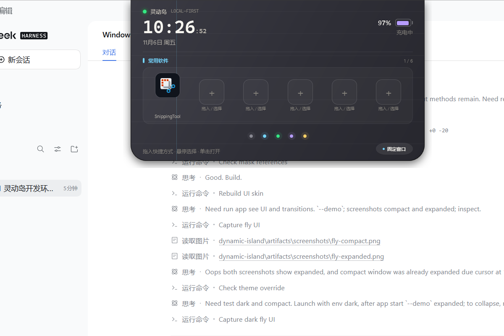

# 软件设计思路

## 1. 产品目标

灵动岛不是另一个“桌面窗口”，而是一个**贴住屏幕顶部的常驻信息层**：

- 平时只占很小一条，显示时间、登录名和状态；
- 鼠标靠近时展开成功能区，移开后自然收回；
- 需要持续操作时，右下角固定窗口；
- 所有功能围绕“少切换、少打断”设计：常用软件、日程、待办、翻译、AI Agent 都在同一块区域完成。

设计原则：

1. **Glanceable**：不展开也能读到最重要的信息。
2. **Local-first**：日历、待办、快捷方式和本地模型请求优先留在本机。
3. **渐进展开**：先给概览，需要时再进入大工作区。
4. **单一视觉语言**：五个功能区共享同一套动画、间距、主题和交互。
5. **可替换**：Core 层不依赖 WPF，窗口、数据源和模型服务可以独立演进。

## 2. 视觉与交互模型

窗口有四个视觉状态：

| 状态 | 用途 | 尺寸（内容区） |
| --- | --- | --- |
| Compact | 贴顶胶囊 | 340 × 38 |
| Expanded | 常规功能区 | 560 × 306 |
| Expanded + Workspace | 翻译 / AI Agent 大工作区 | 720 × 560 |
| Notification | 通知胶囊 | 400 × 118 |

窗口使用透明分层 WPF 窗口，四周预留 14 DIP 阴影空间。定位以屏幕工作区顶部中心为基准，`TopMargin=0` 时胶囊视觉顶边贴住工作区顶部。

交互状态机：

- `MouseEnter` → 展开；
- `MouseLeave` → 320ms 后收起（未固定、未编辑、未拖拽、无菜单时）；
- 点击胶囊 → 激活窗口，进入展开态；
- 右下角固定按钮是唯一的固定入口；
- 翻译 / AI Agent 使用同一套大工作区与悬停策略：光标在功能区内保持展开，移出后按普通规则收起，不自动改写用户的固定状态；
- 待办、翻译、AI Agent 的输入框获得焦点时进入编辑保持，覆盖 IME 候选窗/窗口失活导致的收起；
- 打开 Windows 开始菜单时，胶囊缩成 Compact 并重新置顶，避免开始菜单覆盖拖放目标。

各功能区默认停留策略：

| 功能区 | 默认行为 | 额外保持 |
| --- | --- | --- |
| 常用软件 | 悬停展开，移出收起 | 拖拽快捷方式时保持 |
| Calendar | 悬停展开，移出收起 | 倒计时状态不改变固定状态 |
| 待办事项 | 悬停展开，移出收起 | 输入框聚焦期间保持 |
| 翻译 | 大工作区，悬停展开，移出收起 | 实际输入/IME 活跃期间短暂保持，停止输入 2 秒后恢复 |
| AI Agent | 大工作区，悬停展开，移出收起 | 实际输入/IME 活跃期间短暂保持，停止输入 2 秒后恢复 |

手动“固定窗口”始终优先于上述临时保持。

窗口还有独立的闲置透明度策略：60 秒没有鼠标/键盘交互后平滑降到 45% 不透明度；鼠标进入、移动、点击、滚轮或键盘输入会立即恢复。开始菜单、文件对话框、正在输入或菜单展开期间不触发。

窗口尺寸会根据当前显示器工作区自适应：常规尺寸不变，大工作区在低分辨率或高 DPI 下按比例缩小，保证不超出屏幕。

## 3. 分层架构

```text
DynamicIsland.Core
  ├─ Models/           IslandSettings、IslandMetrics、visual state
  ├─ Layout/           IslandPlacement 顶边居中定位
  └─ Services/         SettingsStore 原子 JSON 持久化

DynamicIsland.App
  ├─ Views/            IslandWindow、SettingsWindow、ShortcutPickerWindow
  ├─ ViewModels/       IslandViewModel、SettingsViewModel、各功能区 VM
  ├─ Services/         日历、翻译/Agent、快捷方式、图标、托盘、启动、日志
  ├─ Interop/          Win32 P/Invoke
  └─ Themes/           Theme.xaml + Dark/Light 调色板

tests/
  └─ DynamicIsland.Core.Tests
```

Core 层不引用 WPF；窗口只负责动画、尺寸、原生句柄和事件，业务状态集中在 `IslandViewModel`。这样动画不会污染日历、待办或模型调用逻辑。

## 4. 窗口与动画



- 透明分层窗口 + `WS_EX_TOOLWINDOW`，不占任务栏。
- 宽度、高度和左侧位置用 WPF 动画；同时用 16ms 原生定时器同步 HWND 高度，避免 WPF 高度动画在收起时“先裁后缩”。
- 展开/收起 560ms，使用 fly-island 的 `cubic-bezier(0.16, 1, 0.3, 1)` 曲线；窗口宽高、四角圆角一起变化。
- 内容 opacity/transform 280ms，展开内容延迟 140ms 从 `-6px` 上移淡入，收起内容延迟 250ms 出现。
- 功能/状态切换时内容层保留短时动态模糊与渐隐；GPU 层级不足时自动降级为渐隐，避免牺牲 60fps。
- UI 形状、配色、尺寸比例和过渡曲线参考 MIT 许可的 [fly-island](https://github.com/flyl1u/fly-island)，WPF 侧为独立重实现。
- 大工作区只改变 Expanded 的目标尺寸，不新增一套窗口，因此主题、焦点和内容状态保持连续。

## 5. 功能区设计

### 常用软件

- 6 个格子，持久化文件路径，不复制软件。
- 支持 `.lnk`、`.exe`、`.url`、`.appref-ms`、`.html`、`.htm`。
- Windows 开始菜单不是标准拖拽源，因此提供“开始菜单应用选择器”作为稳定入口。
- Shell IDList / FileGroupDescriptor 兼容 Shell 拖拽；Store 应用执行别名解析真实包内 exe 图标。

### Calendar

- 优先 Microsoft 365 发布 ICS，失败时回退桌面 Outlook COM。
- `Ical.Net` 展开重复日程；只显示今天。
- 会议开始前 5 分钟进入圆环倒计时，开始后恢复议程。
- 倒计时状态同时同步到 Compact 胶囊。
- 主题缺失时给出“主题未公开”的明确提示。

### 待办事项

- 行内输入/编辑，打勾即完成并从列表删除。
- 完成动画：粒子从勾选处散开，整行淡出，再从 `todos.json` 删除。
- 数据只保存在本机。

### 翻译

- 本机模型服务：Ollama 默认 11434，LM Studio / llama.cpp 使用 OpenAI 兼容接口。
- 支持中 / 英 / 日 / 韩目标语言，Ctrl+Enter 翻译，结果可复制。
- 翻译页使用大工作区；光标在窗口内保持展开，移出后按普通规则收起。
- 输入和结果保存在 ViewModel，收起或切换标签不丢失。

### AI Agent

- 多轮对话，携带最近 18 条上下文。
- 默认与翻译共用模型地址和模型名；可在设置中为 Agent 单独配置 API 地址、模型名和 Bearer API Key。
- Enter 发送、Shift+Enter 换行、Ctrl+Enter 也可发送；IME 候选确认不会误发送。
- 粘贴、复制最后回复、清空、自动滚动。
- 支持文件上传：图片以多模态输入发送；文本/代码、`.docx`、`.xlsx`、`.pptx` 在本地提取文字后随当前问题发送；聊天记录只显示文件名。
- 图片最长边限制 1600px 并转为 PNG，避免超大图片拖慢本地视觉模型。
- 文件内容被当作不可信数据，system prompt 明确禁止执行文件中的指令，降低提示注入风险。
- 当前定位仍是“本地对话型 Agent”：不执行系统命令、不访问未选中的文件、不控制应用。

## 6. 主题系统

- `Palette.Dark.xaml` / `Palette.Light.xaml` 定义同一组画刷和颜色。
- `Theme.xaml` 只保留控件样式，全部通过 `DynamicResource` 引用调色板。
- `ThemeService` 读取 Windows `AppsUseLightTheme`，监听系统偏好变化，并用 2 秒轮询兜底。
- 替换调色板资源字典即可让已打开的灵动岛、设置页、选择器、菜单一起换色。

## 7. 错误处理与隐私

- 网络/模型/日历错误显示可读状态，不弹大量对话框。
- 本机日志只写启动、主题切换和模型调用失败摘要；不写日历令牌。
- 日历 URL、模型地址、快捷方式、待办都保存在 `%LOCALAPPDATA%\DynamicIsland`。
- 只有配置了 ICS 或本地模型时才发起对应请求；没有云端账号体系。

## 8. 扩展方式

新增功能区只需要：

1. 在 `FunctionTab` 增加枚举值；
2. 在 `IslandViewModel` 增加 active 状态、标题和 Footer 文案；
3. 在 `IslandWindow.xaml` 增加一个内容面板和圆点按钮；
4. 如果内容需要大尺寸，复用 `IsWorkspaceActive` 工作区规则；
5. 把业务逻辑放到 `Services` / ViewModel，避免写进窗口代码。

## 9. 已知取舍

- 透明分层 WPF 窗口对逐帧尺寸和阴影控制最好，但 WinUI 3 的原生材质能力更强；当前优先可控性和单文件发布。
- 开始菜单拖拽在 Windows 11 上不稳定，所以选择器是主路径，拖拽是补充。
- 本地模型不做流式输出，先保证简单可靠的请求/取消/错误处理；流式可以作为下一版增强。
- Agent 暂不开放系统工具调用，避免提示注入或误操作；后续如加入，需要明确的权限白名单和用户确认。
