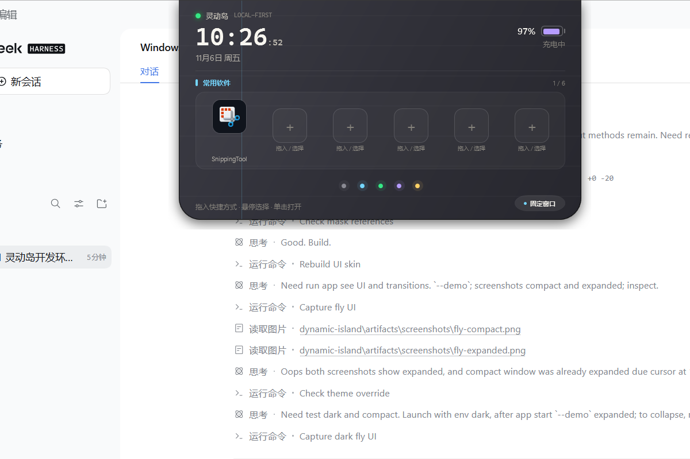
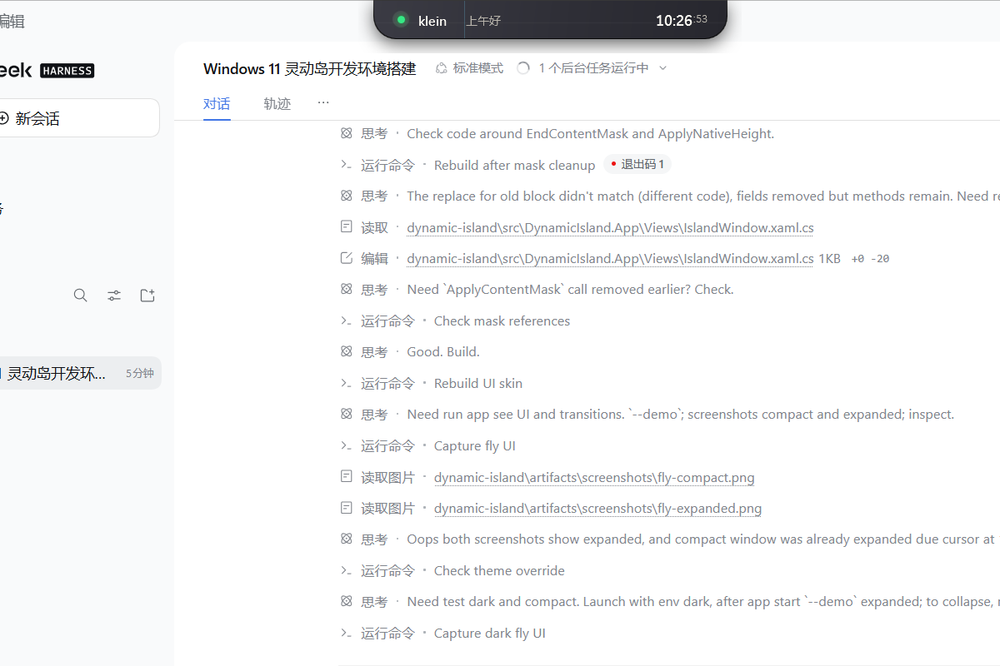

# fly-island UI 参考与移植说明

参考仓库：[flyl1u/fly-island](https://github.com/flyl1u/fly-island)  

紧凑态：

参考提交：`7a7f38e`  
许可证：MIT（Copyright (c) 2026 flyl1u and contributors）

## 原项目架构

fly-island 是 **Tauri 2 + React 19 + TypeScript + Vite** 应用，不是 WPF：

- `src/windows/island/`：岛窗口组合、导航、位置/尺寸、动画样式
- `src/features/`：待办、消息、媒体、剪贴板、外观、更新等领域模块
- `src-tauri/`：窗口定位、透明窗口、托盘、Windows 原生能力
- `IslandShell.css` / `IslandHeader.css` / `tokens.css`：设计令牌和过渡曲线
- `src-tauri/src/island/`：原生窗口几何、玻璃、穿透和状态

它通过 Tauri 动态调整窗口尺寸，React 负责内容切换；默认外观使用 `#2F2F37` 深色、顶部齐平、底部圆角、青色强调色和绿色脉冲。

## 已移植到本项目的部分

本项目保留 WPF 和现有功能，只重写视觉/运动层：

| fly-island | 本软件 |
| --- | --- |
| 顶部齐平、底部圆角 | `Shell` / `ShadowBorder` 使用 `0,0,22,22` → `0,0,30,30` |
| 紧凑态 38px 高、宽 340 | `IslandMetrics` Compact `340 × 38` |
| 展开态 560px 宽 | `IslandMetrics` Expanded `560 × 306` |
| `#2F2F37` 深色表面、顶部高光、网格线 | 深色调色板 + `IslandGridBrush` + 垂直强调线 |
| 青色强调色、绿色 Agent 脉冲、彩色标签点 | `#74D6FF`、`PulseBrush`、五色 `DotTabButton` |
| `cubic-bezier(0.16, 1, 0.3, 1)` | `CubicBezierEasingFunction` |
| 尺寸/圆角过渡 560ms | 窗口宽高/圆角 560ms |
| 内容 opacity/transform 280ms + 延迟 | `SwitchContent` 260/280ms + 140/250ms 延迟 |
| 胶囊/展开态交叉淡入并上移 -6px | 目标内容 `translateY(-6)` → `0` |

## 未直接移植

- fly-island 的 `backdrop-filter` 玻璃折射；WPF 没有等价的实时背景模糊，当前保留短时内容模糊和渐变高光作为近似。
- React/Tauri 的原生窗口尺寸驱动；本项目继续使用 WPF HWND 尺寸同步。
- fly-island 的字体/品牌资产；本项目继续使用系统字体，不复制第三方字体文件。
- 原项目的消息、媒体、剪贴板等功能不在本次移植范围内。

## 保留的功能

常用软件、Calendar、待办、翻译、AI Agent、文件/图片附件、主题、设置、托盘、快捷方式、日历、倒计时、固定窗口、闲置半透明等全部保留。

## 许可证处理

本项目的 UI 形状、颜色令牌和过渡参数参考了 MIT 许可的 fly-island；未复制其源代码文件或图片/字体资产。完整 MIT 许可见仓库根目录 `THIRD_PARTY_NOTICES.md`。
