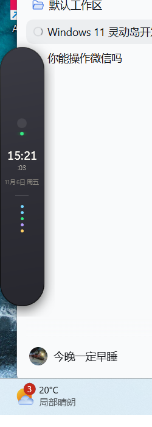

# v0.13.0 更新记录

发布日期：2026-11-06

## 四边吸附拖动

灵动岛不再固定在屏幕顶部居中。按住胶囊空白区域即可自由拖动：

- 松手自动吸附到最近的上 / 下 / 左 / 右边缘
- 不强制回到中心，沿边位置会保留
- 吸附边缘、位置和显示器写入本机设置，重启后恢复
- 拖动期间暂停悬停收起，窗口不会在拖拽中跳回顶部
- 支持多显示器，拖动限制在虚拟屏幕范围内

按钮、输入框、滚动区域和菜单不会误触发窗口拖动。

## 左右竖向 UI

吸附到屏幕左右边缘时自动切换：

| 状态 | 横向 | 竖向 |
| --- | --- | --- |
| 胶囊 | 340 × 38 | 58 × 340 |
| 常规展开 | 560 × 306 | 420 × 720 |
| 翻译 / Agent 工作区 | 720 × 560 | 560 × 720 |

竖向胶囊包含时间、日期、状态点、固定指示；悬停后展开为竖向工作面板。

| 竖向胶囊 | 竖向 Agent |
| --- | --- |
|  |  |

## 定位语义

- `DockOffset` 使用可见内容中心比例，不再按边缘可用空间比例计算
- 切换横向/竖向尺寸时保持中心，不会因宽度/高度变化漂移
- “顶部距离”只影响上边缘；左右和下边缘贴边
- 拖到另一块显示器后，下次启动仍在该显示器

## 验证

- 实测拖动到左 / 右 / 上 / 下边缘均正确吸附
- 左右吸附后窗口切换为竖向尺寸和 `SideCompactView`
- 吸附位置写入 `settings.json`，重启恢复
- 构建 0 警告 0 错误，测试 **17/17** 通过

## 下载

- [DynamicIsland-0.13.0-win-x64.zip](https://github.com/KleinF-02/windows-DynamicIsland/releases/download/v0.13.0/DynamicIsland-0.13.0-win-x64.zip)
- [GitHub Release](https://github.com/KleinF-02/windows-DynamicIsland/releases/tag/v0.13.0)

历史版本：

- [v0.12.1](https://github.com/KleinF-02/windows-DynamicIsland/releases/tag/v0.12.1)
- [v0.12.0](https://github.com/KleinF-02/windows-DynamicIsland/releases/tag/v0.12.0)
- [v0.11.0](https://github.com/KleinF-02/windows-DynamicIsland/releases/tag/v0.11.0)
- [v0.10.0](https://github.com/KleinF-02/windows-DynamicIsland/releases/tag/v0.10.0)
- [v0.9.2](https://github.com/KleinF-02/windows-DynamicIsland/releases/tag/v0.9.2)
- [v0.9.1](https://github.com/KleinF-02/windows-DynamicIsland/releases/tag/v0.9.1)
- [v0.9.0](https://github.com/KleinF-02/windows-DynamicIsland/releases/tag/v0.9.0)
- [v0.8.0](https://github.com/KleinF-02/windows-DynamicIsland/releases/tag/v0.8.0)
- [v0.7.0](https://github.com/KleinF-02/windows-DynamicIsland/releases/tag/v0.7.0)
- [v0.6.0](https://github.com/KleinF-02/windows-DynamicIsland/releases/tag/v0.6.0)
- [v0.5.1](https://github.com/KleinF-02/windows-DynamicIsland/releases/tag/v0.5.1)
- [v0.5.0](https://github.com/KleinF-02/windows-DynamicIsland/releases/tag/v0.5.0)
- [v0.4.0](https://github.com/KleinF-02/windows-DynamicIsland/releases/tag/v0.4.0)
- [v0.3.0](https://github.com/KleinF-02/windows-DynamicIsland/releases/tag/v0.3.0)
- [v0.2.1](https://github.com/KleinF-02/windows-DynamicIsland/releases/tag/v0.2.1)
- [v0.2.0](https://github.com/KleinF-02/windows-DynamicIsland/releases/tag/v0.2.0)
- [v0.1.0](https://github.com/KleinF-02/windows-DynamicIsland/releases/tag/v0.1.0)

完整变更见 [CHANGELOG.md](../../CHANGELOG.md) 和 [版本管理](../versioning.md)。
