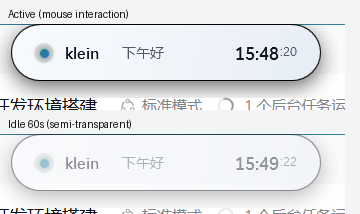

# v0.8.0 更新记录

发布日期：2026-11-05

## 重点更新

### 闲置半透明

- 窗口连续 60 秒没有鼠标/键盘交互后，平滑变为半透明
- 半透明目标为基础透明度的 **45%**
- 淡出 650ms，恢复 220ms，均按 60fps 调度
- 鼠标进入、移动、点击、滚轮或键盘输入后立即恢复不透明

### 触发规则

以下状态不会触发闲置淡出：

- Windows 开始菜单打开
- 文件选择对话框打开
- 右键菜单展开
- 正在输入或中文 IME 活跃
- 拖拽进行中

托盘重新显示时会重置闲置计时。设置页调整窗口透明度后，也会重置并恢复到新透明度。

## 保持不变

- 闲置淡出只改变窗口透明度
- 不改变悬停展开/收起、固定窗口、输入保持或 Agent 会话
- 动画关闭时直接切换透明度，不做过渡

## 验证

- 60 秒后截图确认窗口明显变浅
- 鼠标移动后截图确认恢复不透明
- 构建 0 警告 0 错误，测试 11/11 通过

## 下载

- [DynamicIsland-0.8.0-win-x64.zip](https://github.com/KleinF-02/windows-DynamicIsland/releases/download/v0.8.0/DynamicIsland-0.8.0-win-x64.zip)
- [GitHub Release](https://github.com/KleinF-02/windows-DynamicIsland/releases/tag/v0.8.0)

历史版本：

- [v0.7.0](https://github.com/KleinF-02/windows-DynamicIsland/releases/tag/v0.7.0)
- [v0.6.0](https://github.com/KleinF-02/windows-DynamicIsland/releases/tag/v0.6.0)
- [v0.5.1](https://github.com/KleinF-02/windows-DynamicIsland/releases/tag/v0.5.1)
- [v0.5.0](https://github.com/KleinF-02/windows-DynamicIsland/releases/tag/v0.5.0)
- [v0.4.0](https://github.com/KleinF-02/windows-DynamicIsland/releases/tag/v0.4.0)
- [v0.3.0](https://github.com/KleinF-02/windows-DynamicIsland/releases/tag/v0.3.0)
- [v0.2.1](https://github.com/KleinF-02/windows-DynamicIsland/releases/tag/v0.2.1)
- [v0.2.0](https://github.com/KleinF-02/windows-DynamicIsland/releases/tag/v0.2.0)
- [v0.1.0](https://github.com/KleinF-02/windows-DynamicIsland/releases/tag/v0.1.0)

完整变更见 [CHANGELOG.md](../../CHANGELOG.md) 和 [版本管理](../versioning.md)。
