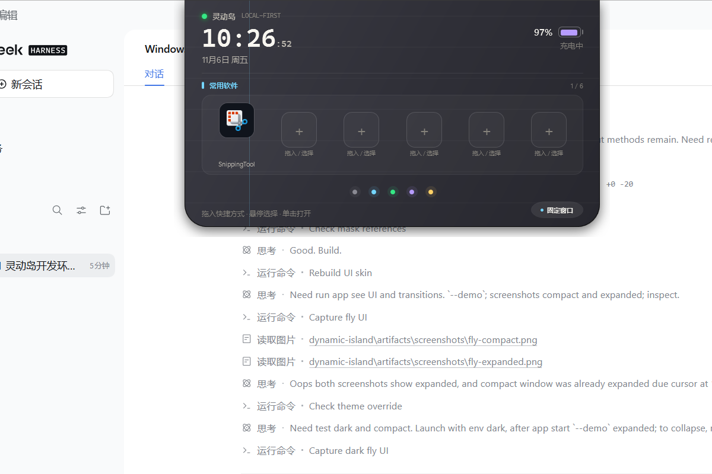

# v0.9.0 更新记录

发布日期：2026-11-06

## fly-island UI 适配

参考 [flyl1u/fly-island](https://github.com/flyl1u/fly-island)（MIT，参考提交 `7a7f38e`）的 UI 结构和过渡节奏，在**不改变现有功能**的前提下重做 WPF 外观。

### 新外观

- 顶部齐平、底部圆角，替代原来的完整胶囊圆角
- 深色表面改为 fly-island 的 `#2F2F37` 系渐变，增加顶部高光、42px 网格线和左侧强调线
- 强调色改为青色，Agent 状态使用绿色脉冲
- 五个功能圆点改为独立颜色与光晕，激活时显示外环
- 按钮改为胶囊形；时钟使用等宽字体，增加“灵动岛 / LOCAL-FIRST”状态条
- 浅色主题同步为暖白玻璃风格，保留深/浅色切换

### 新过渡

- 新增 `CubicBezierEasingFunction`，复刻 `cubic-bezier(0.16, 1, 0.3, 1)`
- 窗口宽高、位置和底部圆角统一为 **560ms**
- 展开内容延迟 140ms、260ms 淡入，并从 -6px 上移
- 紧凑内容延迟 250ms 出现；旧内容 120ms 淡出并上移
- 保留短时动态模糊和 GPU 层级降级，模糊峰值降至 2.4–2.8
- 移除旧的弹簧回弹和 mask 揭示，改为 fly-island 式固定顶边、底部圆角连续过渡

### 尺寸

- Compact：`340 × 38`
- Expanded：`560 × 306`
- 翻译 / Agent 工作区：`720 × 560`
- Notification：`400 × 118`

## 保留的功能

五个功能区、日历、待办、翻译、AI Agent 文件/图片输入、设置、托盘、快捷方式、通知、固定窗口、闲置半透明全部保留；数据格式、模型请求和交互语义未改变。

## 许可

UI 形状、颜色令牌和过渡参数参考 MIT 许可的 fly-island。未复制其源代码文件、图片、品牌或字体资产；完整许可见仓库根目录 `THIRD_PARTY_NOTICES.md`，适配说明见 [docs/fly-island-ui.md](../fly-island-ui.md)。

## 验证

- dark/light 两套主题截图检查
- Compact / Expanded 尺寸与底部圆角检查
- 文件上传、Agent 页面和功能圆点检查
- 构建 0 警告 0 错误，测试 11/11 通过

## 下载

- [DynamicIsland-0.9.0-win-x64.zip](https://github.com/KleinF-02/windows-DynamicIsland/releases/download/v0.9.0/DynamicIsland-0.9.0-win-x64.zip)
- [GitHub Release](https://github.com/KleinF-02/windows-DynamicIsland/releases/tag/v0.9.0)

历史版本：

- [v0.8.0](https://github.com/KleinF-02/windows-DynamicIsland/releases/tag/v0.8.0)
- [v0.7.0](https://github.com/KleinF-02/windows-DynamicIsland/releases/tag/v0.7.0)
- [v0.6.0](https://github.com/KleinF-02/windows-DynamicIsland/releases/tag/v0.6.0)
- [v0.5.1](https://github.com/KleinF-02/windows-DynamicIsland/releases/tag/v0.5.1)
- [v0.5.0](https://github.com/KleinF-02/windows-DynamicIsland/releases/tag/v0.5.0)
- [v0.4.0](https://github.com/KleinF-02/windows-DynamicIsland/releases/tag/v0.4.0)
- [v0.3.0](https://github.com/KleinF-02/windows-DynamicIsland/releases/tag/v0.3.0)
- [v0.2.1](https://github.com/KleinF-02/windows-DynamicIsland/releases/tag/v0.2.1)
- [v0.2.0](https://github.com/KleinF-02/windows-DynamicIsland/releases/tag/v0.2.0)
- [v0.1.0](https://github.com/KleinF-02/windows-DynamicIsland/releases/tag/v0.1.0)

完整变更见 [CHANGELOG.md](../../CHANGELOG.md) 和 [版本管理](../versioning.md)。
