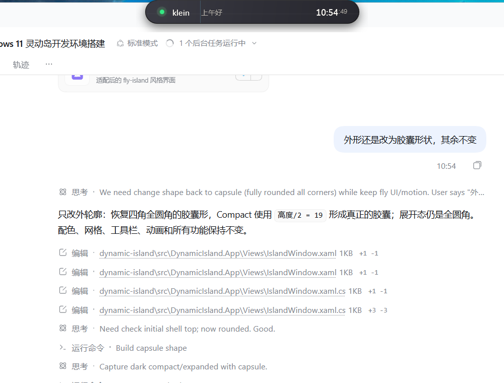

# v0.9.1 更新记录

发布日期：2026-11-06

## 外形调整

- 灵动岛外轮廓恢复为**四角全圆角胶囊**
- Compact 使用 `高度 / 2 = 19`，形成真正的胶囊形
- Expanded 保持 `30` 圆角，翻译 / Agent 工作区保持 `26` 圆角
- 顶部阴影和透明留白行为不变

## 保持不变

- fly-island 风格的深色/浅色表面、网格纹理、强调线、脉冲和彩色功能圆点
- 560ms `cubic-bezier(0.16, 1, 0.3, 1)` 尺寸/圆角过渡
- 260/280ms 内容淡入与位移
- 动态模糊、闲置半透明、所有功能区和数据逻辑

## 验证

- 紧凑态四角为完整胶囊圆角
- 展开态四角全圆角，内容无裁切
- 构建 0 警告 0 错误，测试 11/11 通过

## 下载

- [DynamicIsland-0.9.1-win-x64.zip](https://github.com/KleinF-02/windows-DynamicIsland/releases/download/v0.9.1/DynamicIsland-0.9.1-win-x64.zip)
- [GitHub Release](https://github.com/KleinF-02/windows-DynamicIsland/releases/tag/v0.9.1)

历史版本：

- [v0.9.0](https://github.com/KleinF-02/windows-DynamicIsland/releases/tag/v0.9.0)
- [v0.8.0](https://github.com/KleinF-02/windows-DynamicIsland/releases/tag/v0.8.0)
- [v0.7.0](https://github.com/KleinF-02/windows-DynamicIsland/releases/tag/v0.7.0)
- [v0.6.0](https://github.com/KleinF-02/windows-DynamicIsland/releases/tag/v0.6.0)
- [v0.5.1](https://github.com/KleinF-02/windows-DynamicIsland/releases/tag/v0.5.1)
- [v0.5.0](https://github.com/KleinF-02/windows-DynamicIsland/releases/tag/v0.5.0)
- [v0.4.0](https://github.com/KleinF-02/windows-DynamicIsland/releases/tag/v0.4.0)
- [v0.3.0](https://github.com/KleinF-02/windows-DynamicIsland/releases/tag/v0.3.0)
- [v0.2.1](https://github.com/KleinF-02/windows-DynamicIsland/releases/tag/v0.2.1)
- [v0.2.0](https://github.com/KleinF-02/windows-DynamicIsland/releases/tag/v0.2.0)
- [v0.1.0](https://github.com/KleinF-02/windows-DynamicIsland/releases/tag/v0.1.0)

完整变更见 [CHANGELOG.md](../../CHANGELOG.md) 和 [版本管理](../versioning.md)。
