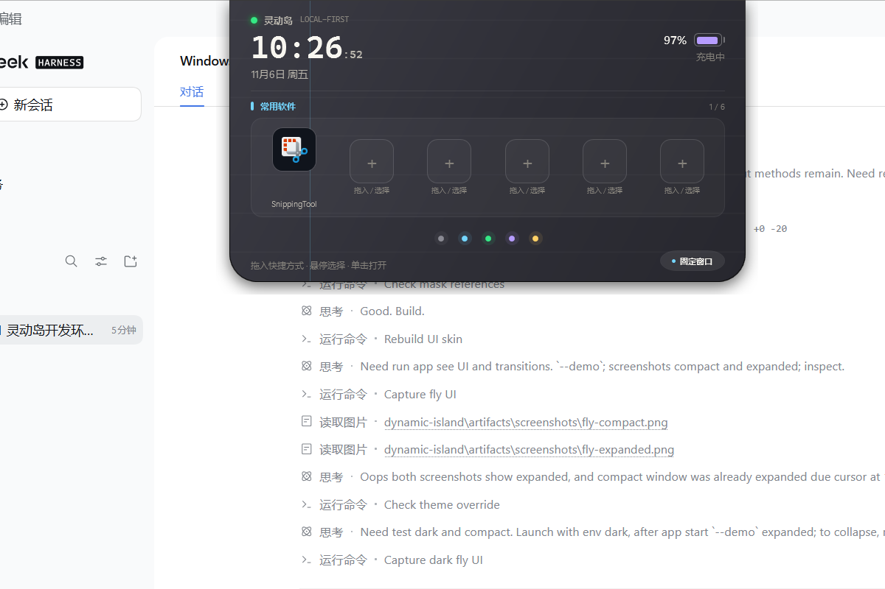
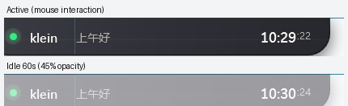
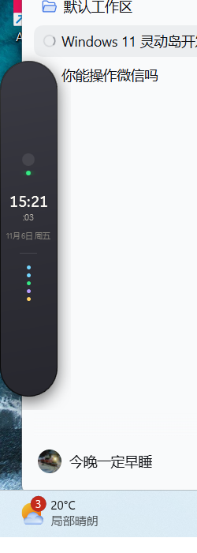
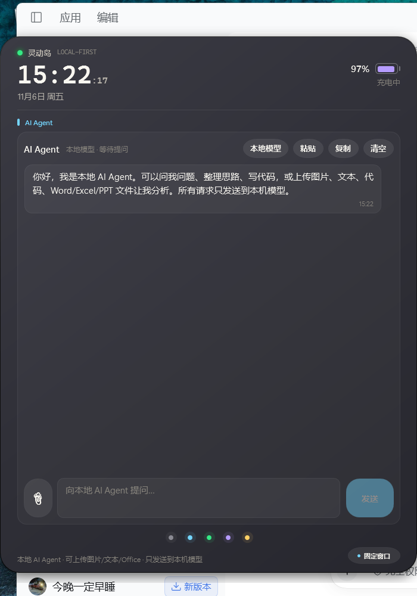
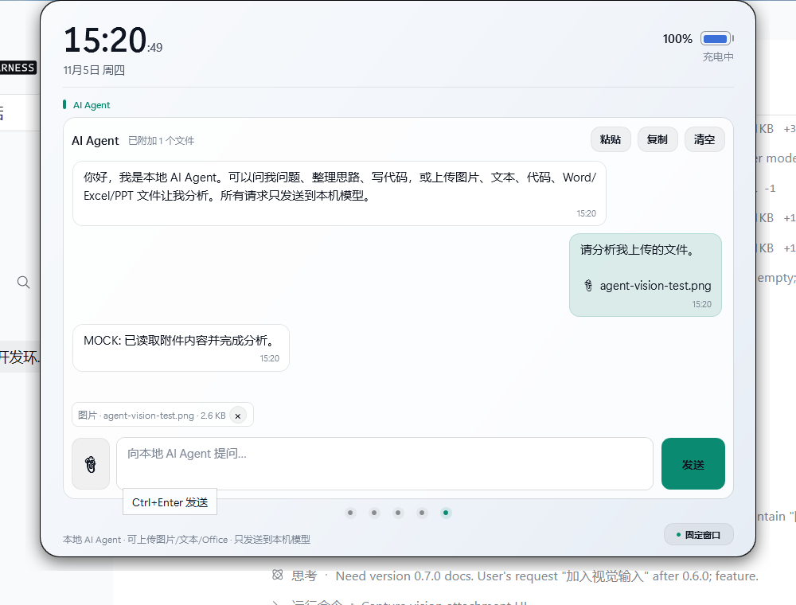

# 使用说明

## 1. 安装与启动

### 直接使用发布包

1. 从 GitHub Releases 下载 `DynamicIsland-0.13.0-win-x64.zip`。
2. 解压到任意目录。
3. 双击 `DynamicIsland.exe`。
4. 首次运行会在桌面顶部出现胶囊，并在系统托盘创建图标。

发布包是自包含的，目标机不需要安装 .NET。若被 SmartScreen 拦截，选择“更多信息 → 仍要运行”。

### 从源码运行

```powershell
.\scripts\bootstrap.ps1
.\scripts\run.ps1
```

或：

```powershell
dotnet build DynamicIsland.sln -c Debug
dotnet run --project .\src\DynamicIsland.App
```

要求 Windows 11 + .NET 10 SDK。

## 2. 基本交互



| 操作 | 效果 |
| --- | --- |
| 按住胶囊拖动 | 自由移动；松手吸附最近屏幕边缘，并记住沿边位置 |
| 吸附到左/右边缘 | 切换为竖向 UI：窄条胶囊 + 竖向展开面板 |
| 鼠标移入胶囊 | 展开功能区 |
| 鼠标移开 | 320ms 后收起（未固定、未在输入时） |
| 左键单击胶囊 | 展开，不改变固定状态 |
| 右下角“固定窗口” | 固定 / 取消固定 |
| 在待办 / 翻译 / Agent 输入框输入 | 待办保持聚焦；翻译/Agent 仅在实际输入或 IME 活跃期间保持，停止输入 2 秒后恢复悬浮收起；未输入时聚焦不会阻止收起 |
| Agent 上传图片/文件 | 文件对话框打开期间保持展开；发送后图片以多模态输入、文本以当前消息上下文发送 |
| 60 秒无交互 | 窗口平滑变为 45% 不透明度；鼠标进入/移动/点击/滚轮或键盘输入恢复不透明 |
| 点击底部圆点 | 切换常用软件 / Calendar / 待办事项 / 翻译 / AI Agent |
| 右键胶囊 / 托盘图标 | 菜单：设置、演示通知、隐藏、退出 |
| 托盘双击 | 显示灵动岛 |
| Alt+F4 | 默认隐藏到托盘，不退出 |

### 闲置半透明



窗口 60 秒没有交互后会平滑变为半透明；移动鼠标、点击、滚轮或键盘输入后恢复。开始菜单打开、文件选择对话框打开、正在输入或菜单展开时不会触发。

### 2.1 窗口拖动与四边吸附

- 按住胶囊空白区域拖动，按钮、输入框、滚动区域不会触发拖动
- 松手后自动吸附到最近的屏幕边缘：上、下、左、右
- 不会强制回到屏幕中心，吸附位置会保存
- 上/下吸附保持横向胶囊；左/右吸附切换竖向 UI
- 拖动到另一块显示器后，下次启动仍在该显示器
- 设置中的“顶部距离”只影响顶边，不影响左右/底边

| 竖向胶囊 | 竖向 Agent |
| --- | --- |
|  |  |

## 3. 常用软件

- 6 个快捷方式格子。
- 从资源管理器或桌面拖入 `.lnk`、`.exe`、`.url`、`.appref-ms`、`.html`、`.htm`。
- 单击格子启动；悬停放大；右上角 `×` 移除。
- 点击空格子会打开开始菜单应用选择器：
  - 搜索并添加桌面应用；
  - 点击“浏览文件…”选择本地 `.html` 或快捷方式。
- HTML 使用默认浏览器打开，图标优先使用系统默认浏览器图标。
- 快捷方式只保存路径，不复制软件本体。

> Windows 11 开始菜单本身通常不是标准拖拽源。直接把开始菜单图块拖到灵动岛可能没有反应，请使用选择器，或先把应用固定到桌面再拖入。

## 4. Calendar 与会议倒计时

### 配置 Microsoft 365 网页日历

1. 打开 Outlook 网页版。
2. **设置 → 日历 → 共享日历 → 发布日历**。
3. 选择日历，权限建议选 **可查看所有详细信息**，发布并复制 ICS 链接。
4. 打开灵动岛 **设置 → 日历**，粘贴到“Outlook 网页日历”输入框并保存。
5. 切到 Calendar，点“刷新”。

注意：

- 权限选“仅忙闲”时 ICS 不包含会议主题，应用会显示“主题未公开”。
- ICS 链接含私人访问令牌，不要分享设置文件或截图。
- 未配置 ICS 时会尝试桌面版 Outlook COM。

### 倒计时

- 下一场未开始、非全天会议距开始 ≤ 5 分钟时，自动显示圆环倒计时。
- 倒计时同时显示在展开页和缩小后的顶部胶囊。
- 会议开始时自动退出倒计时，恢复今日日程。

## 5. 待办事项

- 在输入框输入后回车，或点 `+`。
- 直接点击已有待办文字可修改。
- 点左侧圆圈打勾：粒子散开、整行淡出，并从列表和本地文件删除。
- 最多 20 条，每条最多 120 字。

## 6. 模型：翻译与 AI Agent

翻译和 AI Agent 默认共用同一份本地模型配置；AI Agent 可以在设置里单独覆盖 API 地址、模型名和 API Key。

### Ollama（推荐）

```powershell
ollama serve
ollama pull qwen2.5:7b
```

打开 **设置 → 翻译**：

- 服务地址：`http://127.0.0.1:11434`
- 模型名：可填 `qwen2.5:7b`，留空自动选择第一个模型

### LM Studio / llama.cpp

在 LM Studio 中启动 Local Server，然后在设置里填写：

```text
http://127.0.0.1:1234
```

OpenAI-compatible 服务会自动使用 `/v1/chat/completions`；Ollama 默认使用 `/api/chat`。

### AI Agent API（可选）

打开 **设置 → AI Agent API**，先选供应商：

| 供应商 | 预设地址 | 默认模型 | 协议 |
| --- | --- | --- | --- |
| 本地模型 | 上方本地模型地址 | 上方本地模型名 | 自动 |
| 自定义 / OpenAI 兼容 | 手动填写 | 手动填写 | 自动 |
| DeepSeek | `https://api.deepseek.com` | `deepseek-chat` | OpenAI |
| Kimi（Moonshot） | `https://api.moonshot.cn/v1` | `kimi-latest` | OpenAI |
| GLM（智谱） | `https://open.bigmodel.cn/api/paas/v4` | `glm-4-flash` | OpenAI |

选择预设会填入地址和默认模型，仍可手动修改：

- **API Key**：以 `Authorization: Bearer <key>` 发送，可留空
- Agent 面板右上角的模型按钮可在不打开设置的情况下切换供应商，默认本地模型
- 供应商预设会强制使用 OpenAI-compatible 协议，避免 GLM 的 `/api/paas/v4` 被误判为 Ollama
- 手动填写 API 地址或模型名时，会自动从“本地模型”切到“自定义 API”，不会继续走本地
- 留空 API 地址/模型名并选择本地模型时，Agent 自动回退到上方本地模型配置
- 需求中写作 `gml` 的供应商按 **GLM（智谱）** 实现；如果你的服务不是 GLM，请选择“自定义”

API Key 只保存在本机 `settings.json`，不会写入日志；共享电脑上建议不要保存长期密钥。

### 翻译

- 输入文字，选择目标语言（中文 / English / 日本語 / 한국어）。
- 点“翻译”或按 `Ctrl+Enter`。
- 结果可复制；收起、切换标签后内容仍保留。
- 激活时窗口放大为 720×560 工作区，离开后恢复。

### AI Agent



- 多轮对话，自动携带最近 18 条上下文。
- 右上角模型按钮默认显示“本地模型”，点击可切换本地模型 / 自定义 API / DeepSeek / Kimi / GLM；切换后立即生效并保存。
- 输入后按 **Enter 发送**，**Shift+Enter 换行**；`Ctrl+Enter` 仍然可用。中文输入法确认候选词时不会误发送。
- 支持粘贴剪贴板、复制最后回复、清空对话。
- 点击输入框左侧的回形针上传文件；支持 PNG/JPG/WEBP/GIF/BMP 图片、txt、md、代码、json、csv、log 等文本格式，以及 `.docx`、`.xlsx`、`.pptx`。
- 图片会等比缩小到最长边 1600px 并转为 PNG，再作为多模态输入发送；需要模型本身支持视觉输入。
- 最多 3 个附件；文本最大 4 MB，图片最大 12 MB，Office 文档最大 16 MB。
- 单文件最多读取 24000 字，合计最多 48000 字，超出会截断并在状态栏提示；图片不计入字数。
- 附件正文只进入本次模型请求；聊天记录只显示文件名，不展示文件全文。
- 窗口策略和翻译一致：光标在功能区内保持展开，移出后收起；不自动改变固定状态。
- 不直接执行 Windows 命令、不访问未选择的文件、不控制应用；PDF 暂不支持。

> 没有启动本地服务或没有加载模型时，状态栏会显示连接失败。先确认 `ollama serve` / LM Studio server 正常运行。

## 7. 主题

- 自动跟随 Windows **设置 → 个性化 → 颜色 → 应用模式**。
- 已打开的灵动岛、设置页、选择器、菜单会在约 2 秒内一起换色。
- 不需要手动重启。

## 8. 设置

设置页支持：

- 始终置顶
- 过渡动画
- 显示秒数
- 开机自动启动
- 不透明度
- 顶部距离（仅上边缘吸附时生效）
- Outlook 网页日历链接
- 本地模型地址 / 模型名
- AI Agent 供应商（自定义 / DeepSeek / Kimi / GLM）及独立 API 地址 / 模型名 / API Key

设置保存在 `%LOCALAPPDATA%\DynamicIsland\settings.json`。

## 9. 数据与隐私

| 内容 | 位置 |
| --- | --- |
| 设置 | `%LOCALAPPDATA%\DynamicIsland\settings.json` |
| 快捷方式 | `%LOCALAPPDATA%\DynamicIsland\shortcuts.json` |
| 待办 | `%LOCALAPPDATA%\DynamicIsland\todos.json` |
| 日志 | `%LOCALAPPDATA%\DynamicIsland\logs\app.log` |

> Agent API Key 保存在 `settings.json` 中，不会写入日志；请勿分享该文件。
| 开机启动 | `HKCU\Software\Microsoft\Windows\CurrentVersion\Run\DynamicIsland` |

- 不包含云端账号体系。
- 只有配置 ICS 时才请求 Outlook 发布链接。
- 翻译 / Agent 只请求设置中的本机模型地址。
- Agent 对话和上传的文件内容只保存在当前进程内存，重启清空；文件正文只发送到设置中的本机模型地址。
- 日志不记录日历令牌。

## 10. 常见问题

### 开始菜单拖不进去

Windows 11 开始菜单通常不提供标准拖拽源。点击空格子，用“开始菜单应用选择器”；或把开始菜单应用先固定到桌面，再拖桌面 `.lnk`。

### Snipping Tool 等 Store 应用图标不正常

应用会读取 `%LocalAppData%\Microsoft\WindowsApps` 的应用执行别名，并解析包内真实 exe 图标。重启应用或移除后重新添加即可刷新图标。

### 日历没有主题

Outlook 发布链接权限可能只有“忙闲”。重新发布，选择“可查看所有详细信息”。

### 翻译 / Agent 连接失败

1. 确认本地服务已启动：`ollama serve` 或 LM Studio Local Server。
2. 确认设置里的地址和端口正确。
3. 确认模型已下载/加载；模型名可以留空自动选择。
4. 检查本机防火墙是否拦截端口。

### 窗口收起后翻译/对话丢失

不会丢失。内容保存在 ViewModel 中；重新展开或切回对应功能区仍在。只有退出应用才会清空 Agent 对话（翻译内容同样不跨重启保存）。

## 11. 更新与卸载

- 更新：退出托盘中的灵动岛，用新版本 zip 覆盖程序文件，保留 `%LOCALAPPDATA%\DynamicIsland` 即可保留设置和数据。
- 卸载：退出应用，删除程序目录；如不再需要，删除 `%LOCALAPPDATA%\DynamicIsland` 和开机启动注册表项。

## 12. 当前限制

- 仅 Windows 11。
- 常用软件最多 6 个。
- 待办最多 20 条。
- 本地模型不做流式输出。
- Agent 不执行系统操作；只读取用户通过文件选择器明确选中的文件。PDF 需要先转换为文本、图片或 `.docx`；图片分析需要模型支持视觉输入。
- 多显示器设置已预留但设置页暂未开放选择，默认主屏。
